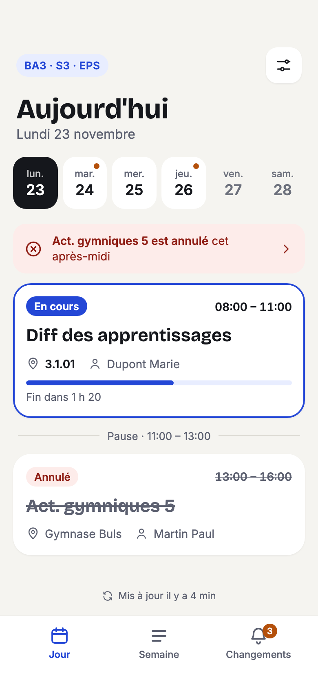
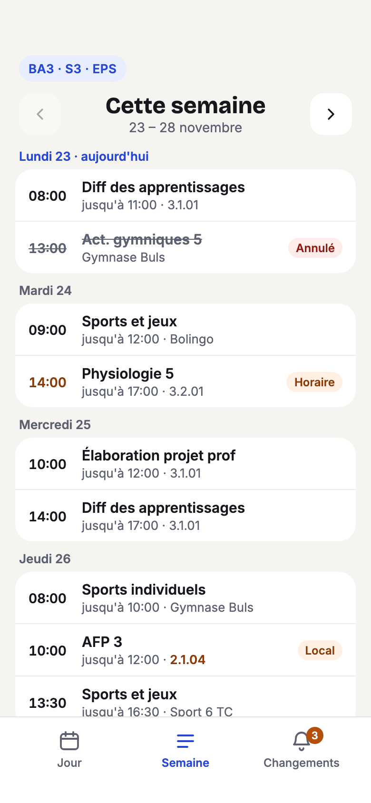
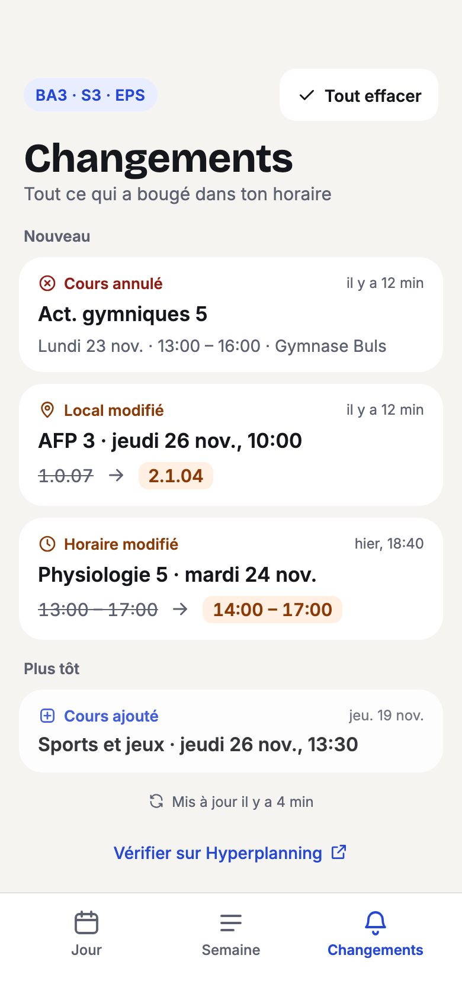
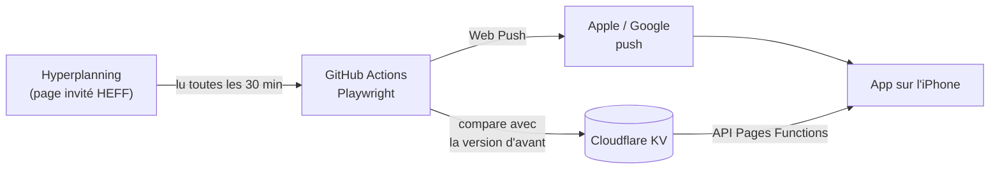

<div align="center">


# Horaire HEFF

**Ton horaire HEFF sur iPhone, avec une notification à chaque changement.**

Cours annulé, local déplacé, horaire décalé : tu le sais avant d'arriver devant une porte fermée.

<a href="https://horaire-heff.pages.dev"></a>


<br><br>

&nbsp;&nbsp;
&nbsp;&nbsp;


<sub>Captures faites avec des données de test. Les noms des enseignants sont fictifs.</sub>

</div>

## Ce que ça fait

| | |
| --- | --- |
| **Notifications** | Un cours annulé, ajouté, déplacé, un changement de local, d'horaire ou d'enseignant : une notification arrive. Plusieurs changements d'un coup donnent une seule notification groupée. |
| **Jour** | Le cours en cours avec le temps restant, les pauses et les cours annulés barrés. |
| **Semaine** | Toute la semaine d'un coup d'œil, les cours modifiés sont signalés. Quatre semaines à l'avance. |
| **Changements** | Le fil de tout ce qui a bougé, avec l'avant et l'après. |
| **Hors ligne** | Le dernier horaire reste lisible sans réseau, en mode Avion ou dans un sous-sol. |
| **Sans compte** | Pas d'inscription, pas d'e-mail. Tu choisis ta promotion et c'est tout. |

## L'installer

1. Ouvre **[horaire-heff.pages.dev](https://horaire-heff.pages.dev)** dans Safari, sur un iPhone avec iOS 16.4 ou plus récent.
2. Touche le bouton Partager, puis **Sur l'écran d'accueil**.
3. Ouvre l'app depuis sa nouvelle icône, choisis ta promotion et active les notifications.

Sur iPhone, les notifications ne marchent que depuis l'app ajoutée à l'écran d'accueil. C'est une règle d'Apple pour les web apps.

## Comment ça marche



- **Lecture.** Une tâche GitHub Actions ouvre la page invité d'Hyperplanning avec un vrai navigateur, toutes les 30 minutes de 6 h à 22 h, du lundi au samedi. Elle lit les quatre prochaines semaines de chaque promotion suivie.
- **Comparaison.** Elle compare avec la lecture précédente cours par cours, et en tire la liste des changements.
- **Garde-fous.** Une lecture ratée ne se fait pas passer pour « tous les cours annulés ». Une semaine qui se vide d'un coup, ou une liste de promotions qui rétrécit, est mise en attente et vérifiée au passage suivant.
- **Envoi.** Les changements sont enregistrés dans Cloudflare KV et envoyés en Web Push aux iPhone abonnés à cette promotion.

## Stack

| Partie | Outils |
| --- | --- |
| App | [Preact](https://preactjs.com), [Vite](https://vite.dev), TypeScript, service worker |
| API | Cloudflare Pages Functions, Cloudflare KV |
| Synchronisation | GitHub Actions, [Playwright](https://playwright.dev), [web-push](https://github.com/web-push-libs/web-push) |
| Tests | [Vitest](https://vitest.dev), Testing Library |

Tout tient dans les offres gratuites de GitHub et Cloudflare.

## Développer

```sh
npm install
npm run dev         # l'app en local
npm test            # les tests
npm run typecheck
```

La mise en ligne complète (clés VAPID, KV, secrets, vérifications) est dans [DEPLOY.md](DEPLOY.md).

## Licence

[MIT](LICENSE). Projet indépendant, sans lien officiel avec la HEFF. Les horaires viennent de la page invité publique d'Hyperplanning.
